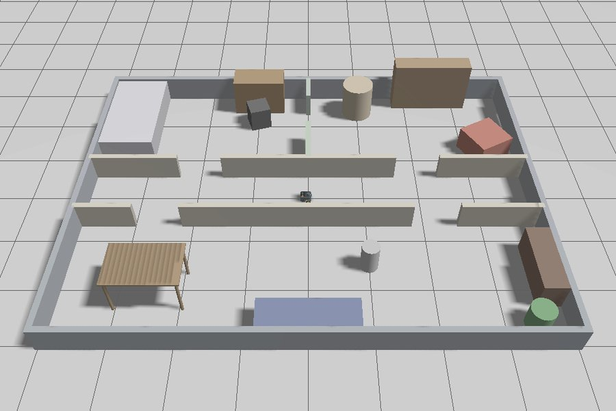
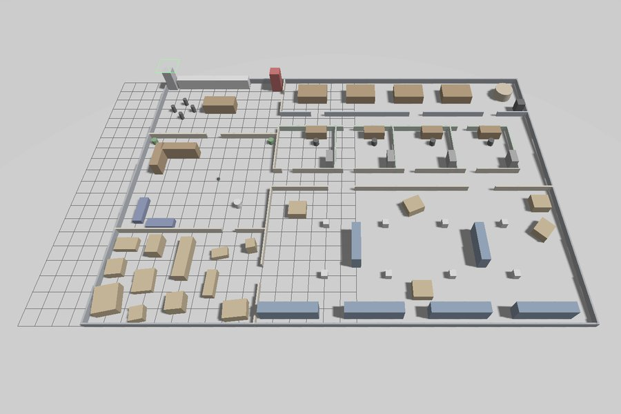
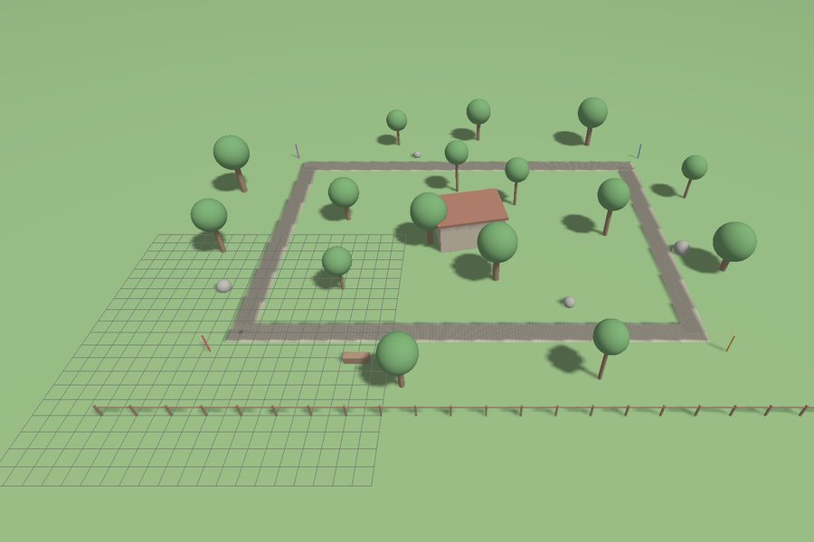

# Caretta Simulator

Gazebo simulation of [Caretta](https://github.com/field-stack-robotics/caretta), our small, open source indoor robot that runs ROS 2.

https://github.com/user-attachments/assets/5369956b-e824-4f32-9cb9-5ca2b4d7fa6d

| World | Purpose |
|---|---|
| `caretta_empty` | Empty world (default) |
| `caretta_house` | Corridor and three rooms, for SLAM and navigation |
| `caretta_office` | 30 x 20 m building, for harder SLAM |
| `caretta_outdoor` | Open field, for GPS |

## 1. Install

Install the simulation on your computer, then drive Caretta in Gazebo, step by step.
The same guide is on our website: [Try Caretta](https://fieldstackrobotics.com/try.html).

**Requirements:**

- Ubuntu 22.04
- [ROS 2 Humble](https://docs.ros.org/en/humble/Installation.html)

> [!NOTE]
> Using a different system? A Docker version will be available soon.

First, install the tools we need:

```bash
sudo apt install python3-rosdep python3-colcon-common-extensions git \
  ros-humble-teleop-twist-keyboard
```

- `rosdep`: installs the dependencies
- `colcon`: builds the packages
- `git`: downloads the repos
- `teleop_twist_keyboard`: drives the robot with the keyboard

### 1.1 Download the repos

Create a workspace folder and go into its `src` folder:

```bash
mkdir -p ~/caretta_ws/src
cd ~/caretta_ws/src
```

Download the robot repo. The simulation needs its model and controllers:

```bash
git clone -b humble https://github.com/field-stack-robotics/caretta.git
```

Then download the simulation repo:

```bash
git clone -b humble https://github.com/field-stack-robotics/caretta_simulator.git
```

<details>
<summary>Terminal output</summary>

```console
user@ubuntu:~/caretta_ws/src$ git clone -b humble https://github.com/field-stack-robotics/caretta_simulator.git
Cloning into 'caretta_simulator'...
remote: Enumerating objects: 97, done.
remote: Counting objects: 100% (97/97), done.
remote: Compressing objects: 100% (53/53), done.
Receiving objects: 100% (97/97), 169.23 KiB | 1.45 MiB/s, done.
Resolving deltas: 100% (38/38), done.
```

</details>

### 1.2 Build the workspace

Set up `rosdep`. You only need this once per computer, so skip it if it says "already exists":

```bash
sudo rosdep init
```

Go back to the workspace, update the package list and install everything the repos need:

```bash
cd ~/caretta_ws
rosdep update
rosdep install --from-paths src --ignore-src -y
```

Now, build the packages:

```bash
colcon build
```

<details>
<summary>Terminal output</summary>

```console
user@ubuntu:~/caretta_ws$ colcon build
Starting >>> caretta_control
Starting >>> caretta_description
Starting >>> caretta_localization
Starting >>> caretta_rviz_plugins
Starting >>> caretta_navigation
Finished <<< caretta_control [1.00s]
Finished <<< caretta_navigation [1.01s]
Finished <<< caretta_localization [1.03s]
Finished <<< caretta_description [1.05s]
Starting >>> caretta_gazebo
Finished <<< caretta_gazebo [0.71s]
Finished <<< caretta_rviz_plugins [16.7s]
Starting >>> caretta_navigation_outdoor
Finished <<< caretta_navigation_outdoor [1.06s]

Summary: 7 packages finished [18.1s]
```

</details>

Finally, source the workspace so ROS 2 can find the packages:

```bash
source install/setup.bash
```

> [!CAUTION]
> **Having a problem?** Ask us on [Discord](https://discord.gg/NCBbzgu32).

## 2. Start the simulation

### 2.1 Launch Gazebo

Start Gazebo and RViz with the house world:

```bash
ros2 launch caretta_gazebo gazebo.launch.py rviz:=true world:=caretta_house
```

<details>
<summary>Terminal output</summary>

```console
user@ubuntu:~/caretta_ws$ ros2 launch caretta_gazebo gazebo.launch.py rviz:=true world:=caretta_house
[INFO] [ign gazebo-1]: process started
[INFO] [robot_state_publisher-2]: process started
[INFO] [parameter_bridge-3]: process started
[INFO] [image_bridge-4]: process started
[INFO] [rviz2-5]: process started
[INFO] [ekf_node-6]: process started
...
[create-7] [INFO] [ros_gz_sim]: Requested creation of entity.
[create-7] [INFO] [ros_gz_sim]: OK creation of entity.
[INFO] [twist_mux-9]: process started
[ign gazebo-1] [INFO] [gz_ros2_control]: System Successfully configured!
[spawner-8] [INFO] [spawner_joint_state_broadcaster]: Configured and activated joint_state_broadcaster
[spawner-8] [INFO] [spawner_joint_state_broadcaster]: Configured and activated diff_drive_controller
```

</details>

You can also try the other worlds, `caretta_office` and `caretta_outdoor`. Without `world:=` you get an empty world.

<table>
  <tr>
    <td align="center"><br><code>caretta_house</code></td>
    <td align="center"><br><code>caretta_office</code></td>
    <td align="center"><br><code>caretta_outdoor</code></td>
  </tr>
</table>

### 2.2 Drive with the keyboard

Open a new terminal, source the workspace and start the keyboard teleop:

```bash
source ~/caretta_ws/install/setup.bash
ros2 run teleop_twist_keyboard teleop_twist_keyboard \
  --ros-args -r cmd_vel:=cmd_vel_teleop
```

`i` drives forward, `j` and `l` turn, `k` stops. Keep this terminal selected while you drive.

### 2.3 Emergency stop

Stop the robot. Every velocity command (teleop and Nav2) is blocked:

```bash
ros2 topic pub --rate 10 /e_stop std_msgs/msg/Bool "data: true"
```

Wait until the robot stops, then press **Ctrl+C**. It stays stopped. Do not use `--once`: the single message can get lost.

Release it, the robot accepts commands again:

```bash
ros2 topic pub --times 10 --rate 10 /e_stop std_msgs/msg/Bool "data: false"
```

> [!CAUTION]
> **Having a problem?** Ask us on [Discord](https://discord.gg/NCBbzgu32).

## 3. SLAM and navigation

Build a map and send Caretta to a goal. Both steps are in the robot repo:

- [SLAM](https://github.com/field-stack-robotics/caretta#3-slam)
- [Navigation](https://github.com/field-stack-robotics/caretta#4-navigation)

## 4. Topics

Sensors:

- `/scan`: LiDAR
- `/camera/image_raw`: camera
- `/imu`: IMU (BNO055, 100 Hz)
- `/diff_drive_controller/odom`: wheel odometry
- `/odometry/filtered`: EKF output, wheel odometry + IMU (also the TF `odom` -> `caretta_base_footprint`)

Velocity commands (`twist_mux` picks one; the higher priority wins):

- `/cmd_vel_teleop`: keyboard, priority 100
- `/cmd_vel`: autonomous navigation (Nav2), priority 10
- `/e_stop`: `std_msgs/Bool`, `true` stops the robot

## 5. License

Apache-2.0
